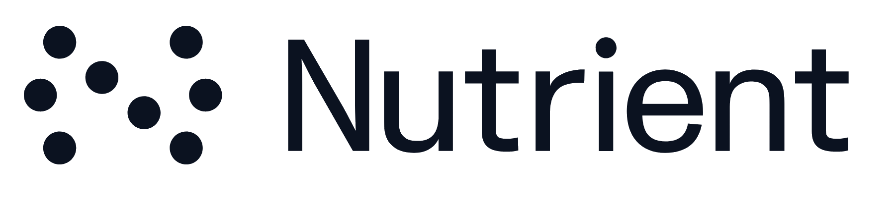
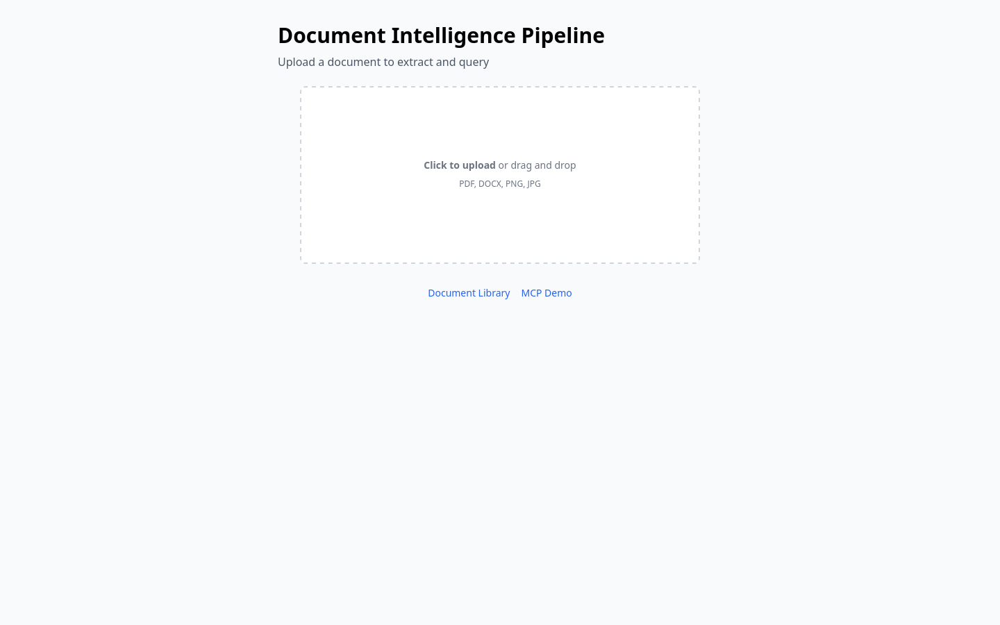
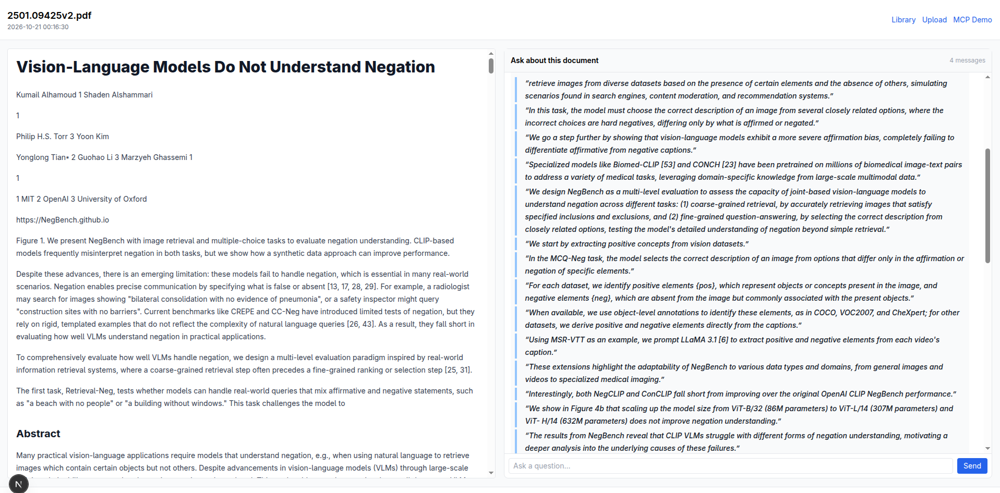

<p align="center">
  <picture>
    <source media="(prefers-color-scheme: dark)" srcset="./nutrient-logo-dark.png" />
    
  </picture>
</p>

<h1 align="center">NutrientLoop</h1>

<p align="center">
  <strong>An end-to-end document intelligence pipeline built on the Nutrient DWS APIs</strong>
</p>

> **Unofficial project — not affiliated with Nutrient.** NutrientLoop is an independent,
> community-built reference implementation. It is **not** an official Nutrient product and is
> **not** endorsed by, sponsored by, or affiliated with Nutrient (formerly PSPDFKit GmbH).
> “Nutrient” and the Nutrient logo are trademarks of their respective owner and are used here
> only to identify the API this demo integrates with. See
> [Legal & attribution](#legal--attribution).

<p align="center">
  <a href="#quick-start">Quick start</a> ·
  <a href="#what-it-does">What it does</a> ·
  <a href="#demo">Demo</a> ·
  <a href="#mcp-server">MCP server</a>
</p>

---

## Why this project exists

Every document AI product eventually needs the same three things: get bytes off a user's
machine, turn them into structure, and answer questions about them. **NutrientLoop** is a small,
complete, runnable reference for exactly that pipeline. It uses the real
[Nutrient DWS](https://www.nutrient.io) extraction API end to end — not a mock — so what you see
here behaves like a real integration.

It is intentionally compact: one framework, one database, one API route per action, and no
build-time configuration beyond a single API key. Read it top to bottom and you understand the
whole flow in an afternoon; run it and you can watch a PDF become searchable markdown in about
three seconds.

---

## What it does

### 1. Drag-and-drop upload → `/`

Accepts `.pdf`, `.docx`, `.png` and `.jpg` (up to 25 MB). The file never touches disk in the
browser — it is streamed as multipart form data to `/api/process` while a progress bar reports
the three stages: `Uploading → Processing → Extracting`. Type and size are checked on both the
client and the server, so a bad file is rejected with an inline message instead of a silent
failure.

### 2. Cloud extraction → Nutrient DWS

The API route authenticates with a bearer token and calls the Nutrient Data Extraction Parse
endpoint with `mode: "understand"` and `output.format: "markdown"`. Nutrient returns the document
body as clean markdown plus metrics (pages processed, processing time).

### 3. Local persistence → SQLite

The markdown and a small metadata record are stored in `data/documents.db` under a generated UUID.
The table is created on first run; there are no migrations and no schema tooling. A library index
exposes each document's filename, ingestion date and page count.

### 4. Two-pane reading view → `/document/[id]`

- **Left pane** — the extracted markdown rendered with `react-markdown` and styled with Tailwind
  Typography.
- **Right pane** — a chat panel that answers questions using the document as its only source;
  answers are rendered as markdown so bold text and quotes format correctly.

### 5. Document-grounded Q&A → `/api/ask`

The system prompt pins the model to the supplied document and instructs it to say so when an
answer is not present. Conversation history is threaded through so follow-up questions resolve
correctly.

When `OPENAI_API_KEY` is not set, the route answers **deterministically from the document
instead of returning a dead end**. The in-repo answerer (`lib/answer.ts`) ranks passages by
keyword overlap and has targeted helpers for the questions people actually ask:

- **Totals and amounts** — picks the most specific line that states a figure (`Total Due` /
  `Grand Total` before `Subtotal` before `Tax`), and honours a question that asks for a
  specific one.
- **Dates** — returns the dated lines.
- **Named parties** — returns the billing/contact lines, falling back to capitalised names.
- **"How many"** — counts occurrences of the noun phrase in the document.

It also flattens the HTML tables Nutrient emits and joins label/value lines that the extractor
splits, so invoice fields stay together. Every answer is grounded in the extracted text — when
the answer is not present it says so rather than inventing one — so the chat is useful with zero
API cost. Set the key and the same endpoint switches to the LLM transparently.

### 6. MCP integration walkthrough → `/mcp-demo`

Shows the Cursor / Claude Desktop configuration for the real Nutrient DWS MCP Server, then runs
the same kind of request against this app's own backend: it takes the most recently processed
document and applies a prompt to it ("Extract all dates and amounts…"). The real MCP server runs
inside the AI client rather than inside a web app, so running it here shows the whole flow.

## Demo


▶️ **[Watch the full-resolution video](https://github.com/NullLabTests/NutrientLoop/blob/main/media/demo.mp4?raw=true)**

The recording is a real session captured from a browser, not a mock-up. It shows the complete
loop: selecting a PDF invoice, the Nutrient extraction round-trip, the rendered markdown in the
left pane, a chat question, the document library, and the MCP walkthrough.

> **Note on playback:** GitHub renders READMEs through a sanitiser that strips `<video>` tags and
> does not auto-play repository-hosted `.mp4` files. The animated GIF above is therefore the
> inline preview; the link opens the full-resolution recording.

## Screenshots

| Upload | Results + chat |
| --- | --- |
|  |  |

### Real document: an AI research paper



The pipeline is not invoice-specific — it handles real research PDFs too. Here an arXiv paper
(`2501.09425v2`, *"Vision-Language Models Do Not Understand Negation"* by Alhamoud, Alshammari,
Tian, Li and Ghassemi) was dropped into the uploader:

- **Left pane** — the whole paper extracted to markdown and rendered with typography styling:
  the title, author list, affiliations, and the abstract all come back as clean, structured text.
- **Right pane** — the chat answers questions using only the paper's own content, quoting the
  passages it drew from (e.g. the NegBench task design and the finding that scaling model size
  does not improve negation understanding). Nothing is invented: if the answer is not in the
  paper, the chat says so.

This is the same `understand`-mode extraction the invoice demo uses — only the document changes.

---

## How it works

```
User Uploads PDF
      │
      ▼
Next.js API Route  ──►  Nutrient DWS /extraction/parse (cloud)
      │                         │
      │                         ▼
      │                 Markdown + page metrics
      │                         │
      ▼                         ▼
SQLite (local)  ◄──────  store markdown + metadata
      │
      ▼
UI renders markdown + LLM Q&A
```

**Pipeline stages**

| Stage | What happens |
| --- | --- |
| **Upload** | Drag-and-drop or click; the browser POSTs multipart form data to `/api/process` |
| **Process** | The API route validates the request and calls the Nutrient DWS Parse endpoint |
| **Extract** | Nutrient returns structured markdown plus page/processing metrics |
| **Store** | A generated UUID keys the markdown and metadata into SQLite |
| **Render** | `/document/[id]` shows the markdown in the left pane and a chat panel on the right |
| **Ask** | `/api/ask` answers questions from the document only — via the LLM when configured, otherwise deterministically |

### API routes

| Route | Description |
| --- | --- |
| `POST /api/process` | Accepts the uploaded file, calls Nutrient, stores the result, returns `{ id }` |
| `GET /api/document/[id]` | Returns one stored document |
| `GET /api/library` | Returns the document index |
| `POST /api/ask` | Answers a question from the document (LLM, or deterministic fallback) |
| `POST /api/mcp-query` | Runs an MCP-style prompt against the most recent document |
| `GET /api/check-keys` | Reports whether the Nutrient key is configured |

## Project structure

```
app/
├── page.tsx                 # upload page
├── document/[id]/page.tsx   # results + chat
├── library/page.tsx         # document list
├── mcp-demo/page.tsx        # MCP demo
└── api/
    ├── process/route.ts        # upload → extract → store
    ├── document/[id]/route.ts  # fetch one document
    ├── library/route.ts        # document index
    ├── ask/route.ts            # LLM Q&A
    ├── mcp-query/route.ts      # MCP-style prompt against the latest document
    └── check-keys/route.ts     # key-presence probe
components/
├── SiteHeader.tsx    # shared branded header + nav
├── FileDrop.tsx      # drag-and-drop picker
├── MarkdownView.tsx  # react-markdown wrapper (Tailwind Typography)
├── ChatPanel.tsx     # conversation UI (renders answers as markdown)
└── McpConfigBlock.tsx
lib/
├── db.ts       # SQLite setup + queries
├── nutrient.ts # Nutrient DWS API client
└── answer.ts   # deterministic document answerer (no-LLM fallback)
```

## Quick start

```bash
# 1. Clone
git clone https://github.com/NullLabTests/NutrientLoop.git
cd NutrientLoop

# 2. Add your key
cp .env.example .env      # then set NUTRIENT_API_KEY

# 3. Run
docker-compose up
```

Then open [http://localhost:3000](http://localhost:3000).

Without Docker:

```bash
npm install
npm run build && npm start
```

### Running locally

```bash
# set NUTRIENT_API_KEY in .env, then
npm run dev
```

The app shows a friendly **"Add your API key"** notice when `NUTRIENT_API_KEY` is missing.
`OPENAI_API_KEY` is entirely optional — without it the Q&A panels fall back to deterministic
extraction from the document, so they still answer from real content.

## Configuration

| Variable | Required | Description |
| --- | --- | --- |
| `NUTRIENT_API_KEY` | Yes | Nutrient DWS API key used for document extraction |
| `NUTRIENT_EXTRACTION_API_KEY` | Yes | Same key; checked as a fallback |
| `OPENAI_API_KEY` | No | Enables LLM Q&A; omitted = deterministic answers from the document |

Keys are read from `process.env` and never hardcoded.

## MCP server

The [Nutrient DWS MCP Server](https://www.nutrient.io/guides/mcp-server/) lets AI assistants such as
Cursor and Claude Desktop process documents directly. The real MCP server runs **inside the AI
client**, not in this app — this project shows the configuration and walks through the flow.

Add this to your Cursor or Claude Desktop config:

```json
{
  "mcpServers": {
    "nutrient-dws": {
      "command": "npx",
      "args": ["-y", "@nutrient-sdk/dws-mcp-server", "--sandbox", "./documents"],
      "env": {
        "SANDBOX_PATH": "./documents",
        "NUTRIENT_DWS_API_KEY": "YOUR_KEY"
      }
    }
  }
}
```

Visit `/mcp-demo` to run that flow against the most recently processed document.

## Tech stack

- **Frontend** — Next.js 15 App Router, React 19, TypeScript, Tailwind CSS + Tailwind Typography, `react-markdown`
- **Backend** — Next.js API routes (no separate server)
- **Storage** — SQLite via `better-sqlite3`; the table is created on first run (no migrations)
- **AI** — OpenAI API, with a deterministic in-repo answerer when no key is configured
- **Documents** — Nutrient DWS REST API (`https://api.nutrient.io`)
- **Infra** — multi-stage Dockerfile + `docker-compose.yml`, port `3000`

## Design decisions

- **One API route per action** keeps each handler small and testable in isolation.
- **Input is validated on both sides.** Type and size checks live in the upload UI and are
  repeated on the server, so the route stays safe to call directly.
- **SQLite, not a server database.** The demo should run with a single `docker-compose up` and no
  external services; the schema is created on first run.
- **The extraction client is intentionally thin.** It reads the documented
  `response.output.markdown` shape and returns a small typed result, so the API contract is
  visible in one place.
- **The LLM is optional.** Document extraction is the core demo. When no key is present the Q&A
  layer answers deterministically from the document rather than dead-ending, so the app is useful
  out of the box and switches to the LLM the moment a key is supplied.
- **Binary artifacts are kept out of the hot path.** The demo recording lives under `media/`
  while the animated preview sits at the repository root so it renders inline in the README.

## Legal & attribution

**Independent project.** NutrientLoop is a personal/community reference implementation. It is not
an official Nutrient product and is not affiliated with, endorsed by, sponsored by, or supported
by Nutrient (formerly PSPDFKit GmbH). All code and opinions are the maintainers' own.

**Trademarks.** “Nutrient”, the Nutrient name and logo, “PSPDFKit”, and any related marks are
trademarks or registered trademarks of Nutrient and/or its affiliates. All other trademarks are
the property of their respective owners. These marks are used here only to identify the
third-party service this demo integrates with (nominative/descriptive use); their use does not
imply any endorsement, partnership, or sponsorship. If you are a rights holder and would like a
mark removed or used differently, please open an issue and it will be addressed promptly.

**No official assets or credentials.** This repository does not include any Nutrient API keys,
credentials, proprietary content, or confidential material. To run the demo against the real API
you must supply your own Nutrient account and key.

**Third-party terms.** Your use of the Nutrient DWS API is governed by Nutrient's own terms of
service and privacy policy. Nothing in this repository grants you any rights to Nutrient's
services, content, or trademarks.

**Data and privacy.** Documents uploaded to a running instance are sent to the configured
extraction provider (Nutrient DWS) and the extracted result is stored locally in SQLite. Do not
upload confidential, personal, or regulated data to a public or shared instance of this demo.
The sample document, screenshots, and demo recording are illustrative only.

**Third-party content.** The screenshot in this README shows a page from the arXiv paper
*“Vision-Language Models Do Not Understand Negation”* (arXiv:2501.09425), © its authors, and is
included solely to demonstrate the app's rendering. It is not part of the project's code or
documentation and will be removed on request from the rights holder.

**No warranty.** The software is provided “as is”, without warranty of any kind, as set out in
the [MIT License](./LICENSE). The maintainers accept no liability for any use of the software or
of the third-party services it connects to.

**Not legal advice.** This notice is provided for clarity and is not legal advice; consult a
qualified professional for your jurisdiction.

## License

The source code in this repository is released under the [MIT License](./LICENSE). The MIT licence
covers this project's code only — it does not grant any rights to the Nutrient name, logo, or
services, or to any third-party content.
