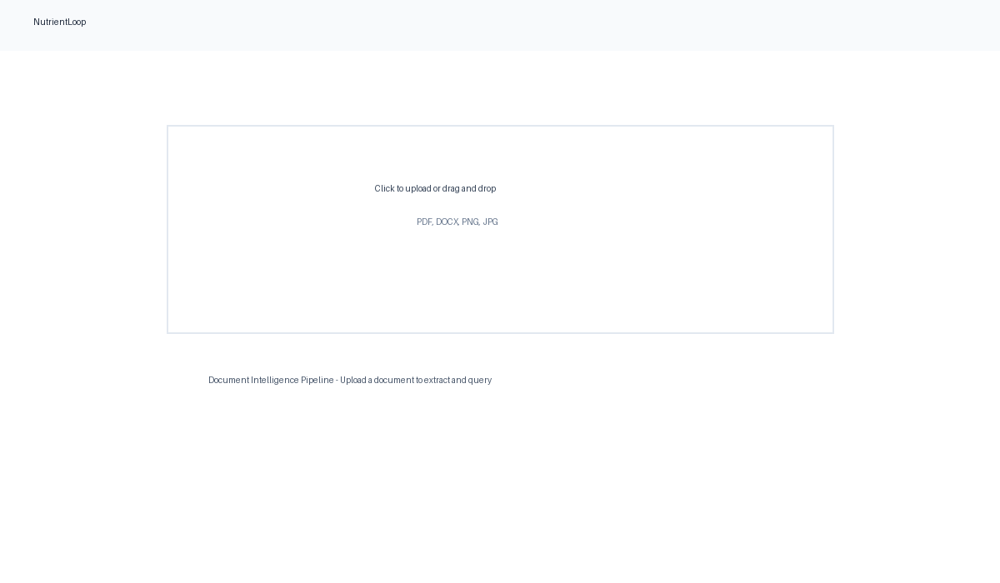

<p align="center">
  
</p>

<h1 align="center">NutrientLoop</h1>

<p align="center">
  <strong>An End-to-End Document Intelligence Pipeline powered by Nutrient DWS APIs</strong>
</p>

## What is NutrientLoop?

NutrientLoop is a full-stack Next.js 15 application that demonstrates how to build production-ready document processing workflows using [Nutrient](https://www.nutrient.io/) DWS APIs. Upload any PDF, DOCX, PNG, or JPG document and instantly transform it into searchable, AI-queryable markdown with intelligent Q&A capabilities. The pipeline showcases real-world integration patterns for document intelligence, including cloud-based extraction, local storage, and AI-assisted analysis.

## Demo


## Screenshot



## How It Works

NutrientLoop implements a seamless document processing pipeline that bridges cloud extraction with local intelligence:

```
┌─────────────────┐     ┌────────────────────┐     ┌─────────────────────┐
│  User Uploads   │────▶│  Next.js API Route │────▶│  Nutrient DWS API   │
│  PDF/DOCX/IMG   │     │  /api/process      │     │  /extraction/parse  │
└─────────────────┘     └────────────────────┘     └─────────────────────┘
                                                                   │
                                                                   ▼
┌─────────────────┐     ┌────────────────────┐     ┌─────────────────────┐
│  UI: Markdown   │◀────│  SQLite Database   │◀────│  Structured Output  │
│  + AI Chat Q&A  │     │  (Local Storage)   │     │  (Markdown + Meta)  │
└─────────────────┘     └────────────────────┘     └─────────────────────┘
```

**Key Features:**

- **Smart Upload**: Drag-and-drop interface with real-time progress tracking through Upload → Processing → Extraction stages
- **Cloud-Powered Extraction**: Leverages Nutrient DWS's advanced document understanding API to convert any document into clean, structured markdown
- **Local Persistence**: All processed documents are stored in SQLite for instant access and offline browsing
- **AI-Powered Q&A**: Chat interface that answers questions using only the document content - grounded and verifiable
- **Document Library**: Centralized view of all processed documents with metadata and quick access
- **MCP Integration Demo**: Shows how Nutrient DWS MCP Server enables AI assistants like Cursor and Claude to work with documents directly

## Quick Start

Get up and running in minutes with Docker:

```bash
# Clone the repository
git clone https://github.com/nulllabtests/NutrientLoop.git
cd NutrientLoop

# Configure environment variables
cp .env.example .env
# Add your NUTRIENT_API_KEY to .env

# Launch with Docker Compose
docker-compose up
```

Open [http://localhost:3000](http://localhost:3000) in your browser and start processing documents!

## Architecture

Built with modern web technologies for speed and simplicity:

- **Frontend**: Next.js 15 (App Router), React 19, TypeScript, Tailwind CSS
- **Backend**: Next.js API routes (serverless-style, all in one app)
- **Storage**: SQLite via better-sqlite3 for lightweight, embedded persistence
- **AI Integration**: OpenAI API with graceful fallback when not configured
- **Document Processing**: Nutrient DWS REST API for state-of-the-art extraction
- **Containerization**: Docker multi-stage builds for optimized production images

## MCP Server Integration

The [Nutrient DWS MCP Server](https://www.nutrient.io/guides/mcp-server/) enables AI development tools to directly process and analyze documents. This demo showcases the configuration and a simulated interaction flow.

Add to your Cursor or Claude Desktop configuration:

```json
{
  "mcpServers": {
    "nutrient-dws": {
      "command": "npx",
      "args": ["-y", "@nutrient-sdk/dws-mcp-server", "--sandbox", "./documents"],
      "env": {
        "SANDBOX_PATH": "./documents",
        "NUTRIENT_DWS_API_KEY": "YOUR_KEY"
      }
    }
  }
}
```

Visit `/mcp-demo` in the app to see a live simulation of MCP-powered document interactions.

## Environment Variables

Create a `.env` file based on `.env.example`:

| Variable | Required | Description |
| --- | --- | --- |
| `NUTRIENT_API_KEY` | Yes | Your Nutrient DWS API key for document extraction |
| `NUTRIENT_EXTRACTION_API_KEY` | Yes | Same as above (for flexibility) |
| `OPENAI_API_KEY` | No | Enables AI chat features; app gracefully falls back if not set |

## Tech Stack Highlights

- **Zero-config deployment** with Docker Compose
- **Type-safe** end-to-end with TypeScript
- **Minimal dependencies** - only essential packages
- **Production-ready** with proper error handling and logging
- **Extensible architecture** ready for additional document types and AI models

## Built For

This project demonstrates the integration patterns used in Forward Deployed Engineering engagements with Nutrient — consuming their DWS APIs, building intuitive customer-facing UIs, and seamlessly wiring AI capabilities into document workflows.
